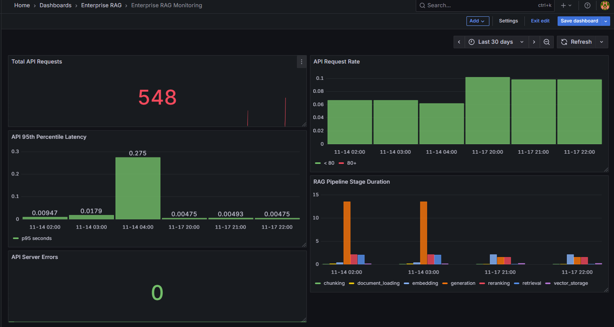
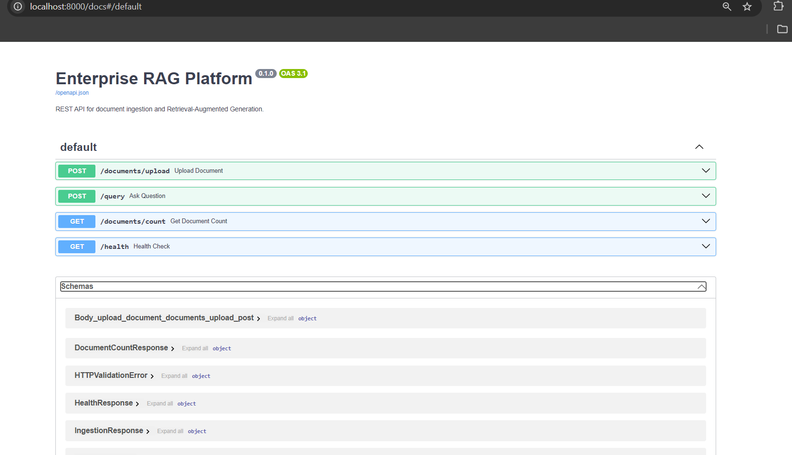

# Enterprise RAG Platform

An end-to-end **Retrieval-Augmented Generation (RAG) platform** for intelligent document processing, semantic search, and context-aware question answering using Large Language Models.

The platform combines document ingestion, text chunking, embedding generation, vector storage, semantic retrieval, reranking, LangGraph workflow orchestration, and LLM-based response generation. It also includes retrieval evaluation, LLM-based answer evaluation, application monitoring, and Docker-based deployment.

## Key Features

- **Document Intelligence:** Upload and process PDF, DOCX, and TXT documents.
- **Semantic Search:** Generate embeddings and store document chunks in ChromaDB.
- **Retrieval-Augmented Generation:** Generate context-aware answers using retrieved document information.
- **Document Retrieval:** Retrieve relevant document chunks using vector similarity search.
- **Reranking:** Improve retrieval relevance using a CrossEncoder reranker.
- **LangGraph Workflow:** Orchestrate retrieval, reranking, context validation, and conditional response generation.
- **LLM Integration:** Use Ollama for local LLM inference.
- **MCP Integration:** Support Model Context Protocol integration.
- **Retrieval Evaluation:** Evaluate retrieval quality using Precision@K, Recall@K, Hit Rate@K, and MRR.
- **LLM-based Evaluation:** Evaluate generated answers using Faithfulness, Answer Relevancy, Context Relevancy, and Answer Correctness.
- **LLM Judge:** Use a separate Qwen2.5:3B model to evaluate generated responses.
- **Monitoring:** Track API performance and RAG pipeline metrics using Prometheus and Grafana.
- **Dockerization:** Run the API and monitoring services using Docker Compose.
- **Persistent Storage:** Preserve vector database, uploaded documents, and monitoring data.

## Monitoring Dashboard

The platform includes Grafana dashboards for monitoring API performance and RAG pipeline execution.



### API Documentation (Swagger UI)

The platform provides interactive API documentation using FastAPI Swagger UI.



## System Architecture

```text
                         USER
                           |
                           v
                         FASTAPI
                      /          \
                     /            \
          DOCUMENT PROCESSING    RAG QUERY
                  |                  |
               CHUNKING           LANGGRAPH
                  |                  |
              EMBEDDINGS         RETRIEVAL
                  |                  |
               CHROMADB          RERANKING
                                     |
                              CONTEXT VALIDATION
                                     |
                                  OLLAMA
                                     |
                              GENERATED ANSWER

              EVALUATION MODULE
                      |
             +--------+---------+
             |                  |
       RETRIEVAL EVAL      LLM EVALUATION
             |                  |
       Precision@K          LLM JUDGE
       Recall@K             Qwen2.5:3B
       Hit Rate@K               |
       MRR                Evaluation Metrics

          MONITORING: PROMETHEUS --> GRAFANA
```

## RAG Workflow

The platform uses a LangGraph-based workflow to manage the question-answering process.

1. **Retrieve:** Fetch relevant document chunks from ChromaDB.
2. **Rerank:** Reorder retrieved chunks using a CrossEncoder model.
3. **Context Validation:** Check whether sufficient relevant context is available.
4. **Generate:** Generate a grounded response using the local LLM.
5. **Insufficient Context:** Return an appropriate response when the retrieved context is insufficient.

### LangGraph Nodes

- `retrieve`
- `rerank`
- `check_context`
- `generate`
- `insufficient_context`

## Evaluation Module

The Evaluation Module measures retrieval performance and generated answer quality.

It consists of two major components:

### 1. Retrieval Evaluation

Retrieval Evaluation measures how effectively the system retrieves relevant document chunks for a given query.

| Metric | Description |
|---|---|
| Precision@K | Measures the proportion of retrieved chunks that are relevant. |
| Recall@K | Measures the proportion of relevant chunks successfully retrieved. |
| Hit Rate@K | Checks whether at least one relevant chunk appears in the top-K results. |
| MRR | Measures the ranking position of the first relevant result. |

### 2. LLM-based Evaluation

An independent LLM Judge evaluates the generated answers using four metrics.

| Metric | Description |
|---|---|
| Faithfulness | Measures whether generated claims are supported by retrieved context. |
| Answer Relevancy | Measures how relevant the generated answer is to the user's question. |
| Context Relevancy | Evaluates the relevance of retrieved context to the query. |
| Answer Correctness | Measures correctness against the expected answer. |

### LLM Model Configuration

| Component | Model |
|---|---|
| Generator Model | Ollama — `llama3.2:1b` |
| LLM Judge | Ollama — `qwen2.5:3b` |
| Embedding Model | `sentence-transformers/all-MiniLM-L6-v2` |
| Reranker Model | `cross-encoder/ms-marco-MiniLM-L-6-v2` |

The Generator and Judge models are configured independently through environment variables.

### Evaluation Dataset

The evaluation dataset contains 30 questions distributed across three categories.

| Category | Question IDs | Count |
|---|---|---:|
| Employee Policy | E01–E10 | 10 |
| Data Understanding | D01–D10 | 10 |
| Sampling | S01–S10 | 10 |
| **Total** | | **30** |

Each dataset record includes the question, expected answer, source document, category, answerability status, and relevant chunk identifiers.

### Evaluation Workflow

1. Load a question from the evaluation dataset.
2. Retrieve the top-K document chunks.
3. Rerank retrieved chunks and select the top-N results.
4. Generate an answer using the selected context.
5. Evaluate the generated answer using the LLM Judge.
6. Calculate evaluation metrics and save results.

**Workflow:**

`Dataset → Retrieval → Reranking → Generation → LLM Judge → Evaluation Results`

### Evaluation Implementation

- `app/evaluation/evaluation_runner.py` — Retrieval evaluation execution.
- `app/evaluation/metrics.py` — Retrieval metric calculations.
- `app/evaluation/llm_evaluator.py` — LLM Judge and structured evaluation.
- `app/evaluation/llm_metrics.py` — LLM evaluation metric aggregation.
- `app/evaluation/llm_eval_runner.py` — End-to-end LLM evaluation execution.
- `app/evaluation/dataset.json` — Evaluation dataset.

Evaluation results are stored in JSON and CSV formats under `app/evaluation/results/`.

## Technology Stack

| Category | Technology |
|---|---|
| Programming Language | Python 3.11 |
| Backend API | FastAPI |
| LLM Runtime | Ollama |
| Generator Model | llama3.2:1b |
| LLM Judge Model | qwen2.5:3b |
| Embedding Model | all-MiniLM-L6-v2 |
| Vector Database | ChromaDB |
| Reranking | CrossEncoder |
| Workflow Orchestration | LangGraph |
| LLM Framework | LangChain |
| Structured Evaluation | Pydantic |
| Monitoring | Prometheus |
| Visualization | Grafana |
| Containerization | Docker |
| Container Management | Docker Compose |
| Testing | Pytest |
| Environment Configuration | python-dotenv |

## Project Structure

```text
enterprise-rag-platform/
│
├── app/
│   ├── api/
│   ├── chunking/
│   ├── core/
│   ├── embeddings/
│   ├── evaluation/
│   ├── generation/
│   ├── graph/
│   ├── ingestion/
│   ├── mcp/
│   ├── monitoring/
│   ├── pipeline/
│   ├── reranking/
│   ├── retrieval/
│   ├── security/
│   └── vectorstore/
│
├── data/
│   └── raw/
│
├── docs/
│   ├── images/
│   └── PROJECT_FOUNDATION.md
│
├── monitoring/
│   ├── grafana/
│   └── prometheus.yml
│
├── scripts/
│
├── tests/
│   └── unit/
│
├── .dockerignore
├── .env.example
├── Dockerfile
├── docker-compose.yml
├── docker-compose.monitoring.yml
├── pyproject.toml
└── README.md
```

## Getting Started

### Prerequisites

- Python 3.11 or higher
- Docker Desktop
- Ollama
- Git

### 1. Clone the Repository

```bash
git clone https://github.com/Pratik327654/enterprise-rag-platform.git

cd enterprise-rag-platform
```

### 2. Configure Environment

Create your local `.env` file using the example configuration.

**Windows PowerShell:**

```powershell
Copy-Item .env.example .env
```

Configure the required environment variables locally.

Do not commit your `.env` file or expose credentials and secrets on GitHub.

### 3. Configure Ollama

Install Ollama and download the required models.

```bash
ollama pull llama3.2:1b

ollama pull qwen2.5:3b
```

Ensure Ollama is running and accessible from the Docker environment.

The Generator and Judge models are configured independently:

```env
LLM_MODEL=llama3.2:1b

JUDGE_MODEL=qwen2.5:3b
```

### 4. Start the Application

Build and start the services:

```bash
docker compose up -d --build
```

Check container status:

```bash
docker compose ps
```

### Application Access

| Service | URL |
|---|---|
| FastAPI | http://localhost:8000 |
| Swagger API Documentation | http://localhost:8000/docs |
| Health Check | http://localhost:8000/health |
| Prometheus | http://localhost:9090 |
| Grafana | http://localhost:3000 |
| Metrics Endpoint | http://localhost:8000/metrics |

## Monitoring and Observability

The platform uses Prometheus to collect application metrics and Grafana to visualize them.

### Monitoring Capabilities

- API request counts
- API request duration
- API error metrics
- RAG pipeline stage duration

### RAG Pipeline Stages

- Document Loading
- Chunking
- Embedding
- Vector Storage
- Retrieval
- Reranking
- Generation

Grafana dashboards provide visibility into application performance, request latency, traffic, errors, and available pipeline-stage observations.

## Testing and Validation

The platform has been validated through:

- API health checks
- Document upload testing
- RAG question-answering tests
- LangGraph workflow testing
- Retrieval and reranking validation
- Retrieval evaluation metrics
- LLM-based evaluation tests
- Prometheus target verification
- Grafana dashboard verification
- Docker container health checks
- ChromaDB persistence testing after API container restart

### Running Unit Tests

Install development dependencies:

```bash
pip install -e ".[dev]"
```

Run the unit tests:

```bash
pytest tests/unit -v
```

### Running LLM-based Evaluation

The evaluation runner can be executed inside the API container:

```bash
docker compose exec api python -m app.evaluation.llm_eval_runner
```

The evaluation process uses:

- The configured Generator model.
- The independently configured Judge model.
- The evaluation dataset containing 30 questions.

Evaluation reports are generated in:

```text
app/evaluation/results/
```

- `llm_eval_results.json`
- `llm_eval_results.csv`

**Note:** Evaluation execution requires the configured Ollama models to be available and Ollama to be accessible from the API container.

## Docker Services

| Service | Container | Port |
|---|---|---:|
| FastAPI | enterprise-rag-api | 8000 |
| Prometheus | rag-prometheus | 9090 |
| Grafana | rag-grafana | 3000 |

Persistent Docker volumes and mounted directories are used to retain application and monitoring data.

## Engineering Documentation

Additional project documentation is available in the `docs/` directory.

- `docs/PROJECT_FOUNDATION.md` — Project foundation, architecture, implementation details, and evaluation documentation.

## Future Enhancements

- Advanced Agentic AI capabilities
- Multi-Agent workflow orchestration
- Improved authentication and authorization
- Advanced observability and alerting
- Production deployment and scalability improvements

## Author

**Pratik Nichalk**

AI Engineering | Generative AI | Machine Learning | RAG | LangGraph

GitHub: [Pratik327654](https://github.com/Pratik327654)

---

If you find this project useful, feel free to explore the repository and its implementation.


